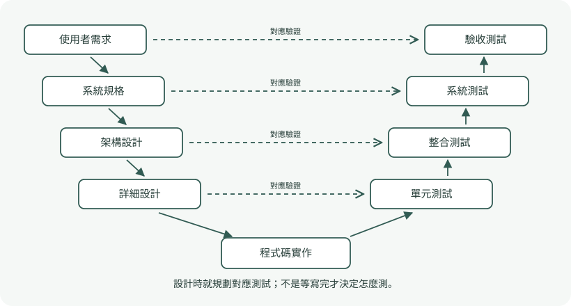

# 第二章｜軟體流程與開發方法學

> 依講義重新整理；頁碼一律指 PDF 頁次。例子標為自編；整理稿尚待使用者複核。

## 本章主線

所有流程都含規格、設計實作、驗證與演化，差別在活動何時發生、多久重複，以及如何取得回饋。流程選型要看需求穩定度、風險、交付時間與變更代價，不能只背「敏捷比較新」。[ASE-002，PDF p.7–9]

## 2.1 Process 與 Process Model

**Software Process** 是實際做的一組活動、方法與實踐；**Process Model** 是對流程的抽象描述，交代活動順序、負責角色、產出工件（Artifacts）及驗證時機。模型是理解與管理流程的藍圖，不等同某一套工具。[ASE-002，PDF p.7–8]

## 2.2 瀑布與 V-Model

**Waterfall 瀑布模型**依序完成需求定義、系統與軟體設計、實作與單元測試、整合與系統測試、維運與維護。階段工件與簽核清楚；風險是可用產品與客戶回饋太晚出現，需求誤解累積到後期才被發現。[ASE-002，PDF p.11–16]

**V-Model** 在定義或設計時就規劃對應測試。重點是測試左移（Shift-Left）與雙向追溯（Traceability），不是最後才補測試。[ASE-002，PDF p.17–21]

| 左側開發層級 | 右側測試層級 | 要確認什麼 |
| --- | --- | --- |
| User Requirements 使用者需求 | Acceptance Testing 驗收測試 | 是否達成使用者要求 |
| System Requirements 系統規格 | System Testing 系統測試 | 整體系統是否符合規格 |
| Architecture Design 架構設計 | Integration Testing 整合測試 | 子系統介面與協作是否正確 |
| Detailed / Module Design 詳細設計 | Unit Testing 單元測試 | 個別模組是否符合設計 |

來源：[ASE-002，PDF p.19]。**圖題提醒**：PDF p.18 的簡化圖把層級合併，分享對話的範例也把架構對應測試寫成 Integration & System Testing。作答時先看該圖的層級切分；詳細四層版按上表，不要只靠某一個選項字面。

| 模型 | 適合情境 | 主要代價 |
| --- | --- | --- |
| Waterfall | 需求穩定、需明確階段工件 | 後期變更與整合昂貴 |
| V-Model | 重視安全、驗證追溯與審查 | 前期規格及測試規劃成本高 |
| 增量／疊代 | 需要早期可用成果與回饋 | 需管理架構演化與整合品質 |

來源：[ASE-002，PDF p.14–23、25–30]。安全關鍵也不等於完全不能疊代；本課案例重點是嚴謹驗證與追溯。

## 2.3 增量、疊代與 MVP

| 比較 | Incremental 增量 | Iterative 疊代 |
| --- | --- | --- |
| 主要改變 | 擴大功能範圍 | 反覆修正與精煉 |
| 自編例 | 先可查課，再加選，再退選 | 查課先純文字，再改善篩選與速度 |
| 提問方式 | 這次多交付什麼？ | 這次把什麼做得更準、更好？ |

來源：[ASE-002，PDF p.25–33]。兩者可以同時使用。**垂直切片（Vertical Slicing）**是一項功能貫穿 UI、邏輯與資料，使它可端到端驗證；先做完所有 DB、再 API、最後 UI，是水平分層，早期未必能給使用者價值。

**MVP（Minimum Viable Product）**的目的，是以最小投入驗證核心假設與取得真實回饋，不是單純少做功能，也不是犧牲必要安全。滑板可以立即代步，單一車輪卻不能驗證代步體驗。雕塑從粗輪廓到細節，則幫助理解疊代精煉。[ASE-002，PDF p.26–34]

## 2.4 敏捷宣言

| 更重視 | 相較於 |
| --- | --- |
| Individuals and Interactions 個人與互動 | Processes and Tools 流程與工具 |
| Working Software 可運行軟體 | Comprehensive Documentation 詳盡文件 |
| Customer Collaboration 客戶合作 | Contract Negotiation 合約協商 |
| Responding to Change 回應變更 | Following a Plan 遵循計畫 |

來源：[ASE-002，PDF p.39–43]。右側仍有價值；敏捷沒有取消規格、文件或計畫。十二原則可用四組理解：早期持續交付與接受變更、業務與開發協作、可持續步調與技術品質、簡約與定期反省。可運行軟體是進度的主要衡量，會議次數與文件頁數不是交付價值。[ASE-002，PDF p.42–44]

## 2.5 Scrum 與 Kanban

| Scrum 責任 | 角色 | 常見混淆 |
| --- | --- | --- |
| 最大化價值、排序 Product Backlog | Product Owner（PO） | 不等於指定每項技術實作 |
| 協助流程有效運作、移除障礙 | Scrum Master（SM） | 不是產品優先級唯一決策者 |
| 規劃實作並交付符合品質的增量 | Developers | 不只是被動接單打字 |

來源：[ASE-002，PDF p.47–50]。

三個工件為 **Product Backlog**（產品待辦清單）、**Sprint Backlog**（本衝刺目標相關工作與計畫）、**Increment**（符合完成定義 DoD 的可用增量）。Sprint 是固定時間盒（Timebox）；講義以 1–4 週介紹。[ASE-002，PDF p.48–50]

| 事件 | 核心目的 |
| --- | --- |
| Sprint Planning | 規劃本輪目標、選擇與安排工作 |
| Daily Scrum | 開發者檢視朝目標的進展並調整計畫；15 分鐘 |
| Sprint Review | 檢視產品成果並取得利害關係人回饋 |
| Sprint Retrospective | 改善團隊協作與工程流程 |

來源：[ASE-002，PDF p.50]。**Review 看產品；Retrospective 看做事方式**。講義將 Sprint 內範疇描述為凍結，這裡保留為課內比較用語；精確實務規則的版本差異列待確認，不以此出「所有變更一律禁止」的客觀題。

**Kanban 看板**強調連續流（Continuous Flow）與拉動（Pull）：下游有容量才拉新工作。**WIP = Work in Progress**；WIP Limit 限制同時進行的工作，讓團隊先完成舊工作、暴露瓶頸，減少多工切換。限制不是要求每人寫更少程式碼。[ASE-002，PDF p.51–55]

| 比較 | Scrum | Kanban |
| --- | --- | --- |
| 節奏 | 固定 Sprint | 持續流動 |
| 角色 | PO、SM、Developers | 不強制 Scrum 角色 |
| 工作限制 | Sprint 計畫與目標 | 明確 WIP 上限 |
| 常用觀察 | Sprint 成果與改進 | Lead Time、Cycle Time、瓶頸 |

來源：[ASE-002，PDF p.47–55]。

## 2.6–2.7 技術債與 XP

**Technical Debt 技術債**是今日省下的設計／實作品質成本，轉為未來每次理解、修改與除錯的額外負擔。「利息」是反覆付出的維護代價，不是雲端租金。**Flaccid Scrum** 指只保留會議與看板等管理外殼，卻缺乏測試與重構的技術實踐。[ASE-002，PDF p.58–62]

**Extreme Programming（XP）**將良好工程實踐持續執行：測試先行、結對編程、簡單設計、重構、持續整合、小型發布與集體所有權。[ASE-002，PDF p.66–74]

| TDD 階段 | 要做的事 | 不應混淆 |
| --- | --- | --- |
| Red | 先寫測試並確認因預期原因失敗 | 不是先寫完整實作 |
| Green | 寫最少實作使測試通過 | 不需一次完成所有未來功能 |
| Refactor | 維持測試通過，改善內部結構 | 不改外部可觀察行為 |

來源：[ASE-002，PDF p.68–70]。測試提供回歸防護，但「全部通過」不構成所有需求皆正確的數學保證。

**Pair Programming**：Driver 實際操作與編碼；Navigator 審查全局、邊界與設計，並交換角色。集體所有權降低只有單一人理解模組的風險（Bus Factor）。[ASE-002，PDF p.71–73]

## 2.8 DevOps 與 CI/CD

**DevOps** 整合開發與維運責任，配合自動化與營運回饋。它不是只安裝某個部署工具。[ASE-002，PDF p.77–81]

| 實踐 | 英文 | 主要特徵 |
| --- | --- | --- |
| 持續整合 | Continuous Integration | 頻繁整合並自動建置、測試 |
| 持續交付 | Continuous Delivery | 通過驗證後保持可發布；發布可保留人工決策 |
| 持續部署 | Continuous Deployment | 通過關卡後自動發布至正式環境 |

來源：[ASE-002，PDF p.78–82]。**IaC（Infrastructure as Code）**以可版本控制的描述管理環境，降低設定漂移；可觀測性的三個常見面向是 **Metrics、Logs、Traces**。自動化降低風險，不代表環境必然百分之百相同或發布永遠零故障。[ASE-002，PDF p.81；後句為整理提醒]

## 2.9 規格驅動 AI 與 Harness

**Engineering Harness** 指包圍模型的規格、權限邊界、執行環境與驗證機制。講義分為上游規格導軌（Context & Spec Rails）、隔離執行沙盒（Execution Sandbox）、下游驗證守門員（Verification Gatekeepers）。[ASE-002，PDF p.85–91]

工作迴路為：人定規格 → AI 實作 → 編譯、靜態分析與測試 → 失敗則修正 → 人工審查。提示詞不能代替確定性工具檢查；工具檢查也不能代替對規格與測試設計的人工判斷。

## 手寫回答策略

遇到流程選型題，寫「情境特性 → 模型 → 關鍵機制 → 代價」。例如：需求穩定且須嚴格追溯的系統，可選 V-Model，因為能早期規劃與追溯各層測試；代價是前期文件及變更成本。這比只寫「醫療所以 V-Model」更完整。[ASE-002，PDF p.20–23；答題架構為自編]

## 來源與延伸

[ASE-002 原始講義](../../../../raw/advanced-software-engineering/lectures/slide02t_process.pdf)。

[本章測驗](../reviews/chapter-02.md) · [課程首頁](../index.md)
