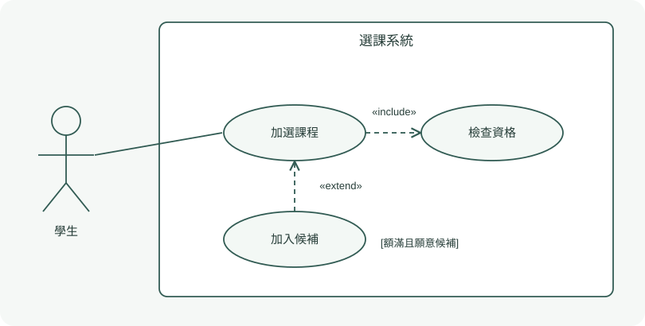
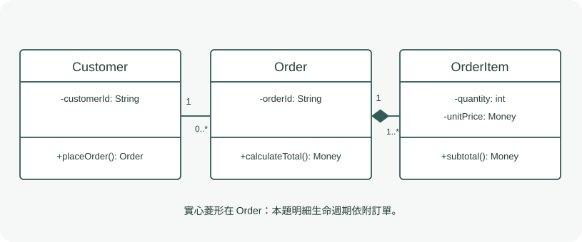
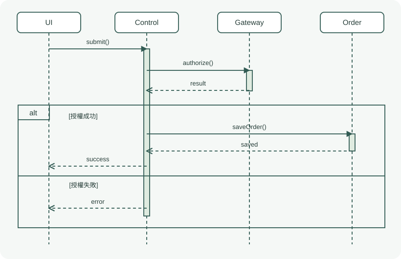
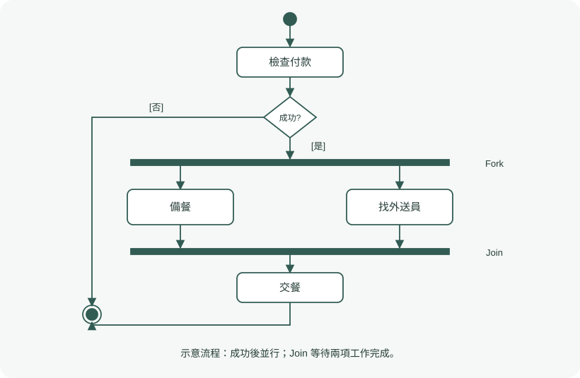
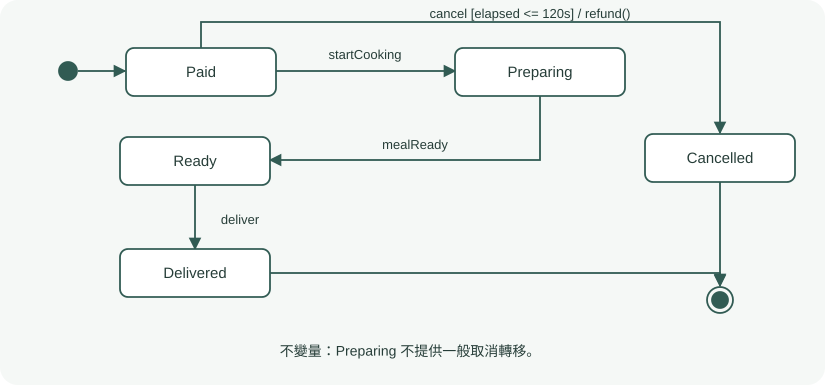
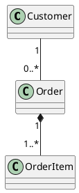

# 第四章｜系統塑模與 UML

> 依講義重新整理；頁碼一律指 PDF 頁次。例子標為自編；整理稿尚待使用者複核。

## 4.1 先學會選圖，再背符號

**System Modeling 系統塑模**以抽象模型描述系統的不同面向，隱藏當下不需要的細節。模型要服務溝通、檢查與實作；單一圖無法代表全部系統。[ASE-004，PDF p.4–8]

| 視角 | 英文 | 關心的問題 | 典型模型 |
| --- | --- | --- | --- |
| 外部 | External | 邊界及外部環境在哪？ | 系統環境／邊界 |
| 互動 | Interaction | 誰與誰互動？ | Use Case、Sequence |
| 結構 | Structural | 資料與類別如何組織？ | Class |
| 行為 | Behavioral | 流程與事件反應如何運作？ | Activity、State Machine |

來源：[ASE-004，PDF p.6–7]。四個分析視角與 UML 官方圖表分類是不同層次的說法；不要把所有動態圖一律當作同一個用途。

## 4.2 UML 是語言，不是開發流程

**Unified Modeling Language（UML）**統一模型記號以利溝通。講義將三位先驅的側重整理為 Jacobson（Use Case、OOSE、Why）、Rumbaugh（OMT、領域與資料、What）、Booch（設計與實作、How）。OMG 推動標準化。[ASE-004，PDF p.10–16]

## 4.3 使用案例圖：角色要達成什麼

| 元素 | 畫法 | 語意 |
| --- | --- | --- |
| Actor | 火柴人或角色標記，放邊界外 | 外部人員角色或外部系統 |
| Use Case | 橢圓，放邊界內 | 能產生可觀察價值的功能目標 |
| System Boundary | 矩形外框 | 本系統負責的範圍 |
| Association | 角色與案例間的實線 | 參與互動，不代表資料流或時序 |

來源：[ASE-004，PDF p.18–26]。以「加選課程」「查詢課表」命名；「點擊送出」通常只是操作步驟。內部資料庫通常不是本系統外部 Actor；是否外部取決於先定義的邊界。

| 關係 | 使用時機 | 箭頭方向 | 線型 |
| --- | --- | --- | --- |
| include | 基礎案例納入必要共用行為 | 基礎案例指向被包含案例 | 虛線開放箭頭，標 «include» |
| extend | 在擴充點、特定條件下加入行為 | 擴充案例指向基礎案例 | 虛線開放箭頭，標 «extend» |
| Generalization | 特化角色／案例可視為一般者的一種 | 子者指向父者 | 實線空心三角 |

來源：[ASE-004，PDF p.20、24、28–31、126]。**include 與 extend 都不能拿來畫步驟先後**。基礎案例不需依賴選用擴充即可有意義地執行。

自編：學生加選時必須檢查資格，故加選 include 檢查資格；名額已滿時可加入候補，故加入候補 extend 加選。手寫先畫邊界、角色與主要目標，再補必要與可選關係。

文字規格還要記錄 Actor、Preconditions、Postconditions、Main Flow、Extensions。圖不應塞入所有例外步驟。[ASE-004，PDF p.27]

## 4.4 類別圖：靜態結構

Class 是藍圖，Object 是實例；方框由類別名、屬性、操作三層組成。屬性可寫 `-studentId: String`；操作可寫 `+enroll(courseId: String): Boolean`。概念模型可較簡潔，實作模型才需進一步細化程式細節。[ASE-004，PDF p.37–40、116]

| 符號 | 英文 | 意義 |
| --- | --- | --- |
| + | Public | 公開 |
| - | Private | 類別內部可見 |
| # | Protected | 受保護，允許子類別等規定範圍 |
| ~ | Package | 套件可見 |

來源：[ASE-004，PDF p.40、116]。具體程式語言的存取規則仍需按語言判讀。

| 關係 | 語意 | 線型與方向 | PlantUML |
| --- | --- | --- | --- |
| Association 關聯 | 物件間結構性連結 | 實線；可加導覽方向 | `A -- B` |
| Dependency 依賴 | A 使用 B | 虛線開放箭頭指向被依賴者 B | `A ..> B` |
| Generalization 泛化／繼承 | 子類別 is-a 父類別 | 實線空心三角指向父類別 | `Parent <|-- Child` |
| Realization 實現 | 類別實現介面契約 | 虛線空心三角指向介面 | `Interface <|.. Implementation` |
| Aggregation 聚合 | 較弱的整體／部分關係 | 空心菱形在整體端 | `Whole o-- Part` |
| Composition 組合 | 部分受整體生命週期管理 | 實心菱形在整體端 | `Whole *-- Part` |

來源：[ASE-004，PDF p.41–43、117]。**三角看父類別／介面；菱形看整體端**。部分可獨立存在，不代表一律必須用聚合；若只表示參照，一般關聯也可能更適合。講義例子中的選擇仍要看其題設。

| 重數 | 意義 |
| --- | --- |
| 1 | 恰好一個 |
| 0..1 | 可有可無，最多一個 |
| * 或 0..* | 零到多個 |
| 1..* | 至少一個 |
| 2..5 | 兩到五個 |

來源：[ASE-004，PDF p.44、51–52]。**讀靠近 B 端的數字，是一個 A 可連到幾個 B**。自編 `Customer "1" -- "0..*" Order`：一位顧客可有零到多筆訂單；每筆訂單恰好對應一位顧客。

常見錯誤：把 has-a 畫成 is-a；把與整體獨立的實體畫成組合；漏兩端重數；將敏感屬性全部公開。組合的圖示是模型的生命週期規則，不會單憑畫圖就自動實作資料庫刪除行為。[ASE-004，PDF p.48–53；末句為整理提醒]

## 4.5 循序圖：跨物件訊息時序

時間由上向下；Lifeline 是參與者的生命線；Activation Bar 表示正在執行操作的期間。呼叫與回傳必須符合因果關係，例如持久化成功後才顯示成功。[ASE-004，PDF p.56–67]

| 訊息 | 視覺辨識 | PlantUML |
| --- | --- | --- |
| 同步呼叫 | 實線、實心箭頭；呼叫者等待 | `A -> B: request()` |
| 非同步訊號 | 實線、開放箭頭；發送者不等完成 | `A ->> B: event` |
| 回傳 | 虛線箭頭，回原呼叫端 | `B --> A: result` |
| 自呼叫 | 箭頭折回自身生命線 | `A -> A: validate()` |
| 銷毀 | 生命線結尾的 X | `destroy B` |

來源：[ASE-004，PDF p.60–61、68、118–119]。**虛線回傳不是非同步的判斷依據**；要連同線型、箭頭與上下文一起看。

| 片段 | 語意 | 對應邏輯 |
| --- | --- | --- |
| alt | 互斥替代分支 | if / else |
| opt | 單一可選分支 | if，無 else |
| loop | 重複執行 | for / while |
| par | 並行片段 | 多條互動並發 |

來源：[ASE-004，PDF p.62–64]。題目有 APPROVED 與 DECLINED 兩個互斥分支，應選 alt，不是 opt 或 par。

**BCE**：Boundary 處理外部互動；Control 協調流程；Entity 保存領域狀態。前端點擊後，由 UI 將請求轉給控制器，再驗證、付款與更新狀態；不要讓 UI 直接下 SQL。[ASE-004，PDF p.65–70]

## 4.6 活動圖：流程、選擇與並行

| 節點 | 畫法 | 用途 |
| --- | --- | --- |
| Initial | 實心圓 | 起點 |
| Action | 圓角矩形 | 執行動作 |
| Activity Final | 靶心圓 | 結束整個活動 |
| Decision | 菱形，通常一入多出 | 依 guard 分支 |
| Merge | 菱形，通常多入一出 | 合併替代路徑，不等待全部 |
| Fork | 粗橫／直條，一入多出 | 展開並行分支 |
| Join | 粗橫／直條，多入一出 | 一般用法等待各並行分支完成 |
| Swimlane / Partition | 橫或直的分區 | 區分角色與責任 |

來源：[ASE-004，PDF p.76–83]。**Decision / Merge 管選擇；Fork / Join 管並行**。不能用 Join 接只會擇一執行的兩條路徑，否則可能等待永遠不會到的另一條。

自編例：付款成功後，「備餐」與「尋找外送員」可並行；兩者完成後才能交餐。付款失敗則結束或返回修正，不應進入備餐。畫泳道時每個動作依執行者歸屬，不是把畫面分好看而已。[ASE-004，PDF p.77–85；例子自編]

## 4.7 狀態機：單一實體如何回應事件

**State** 是物件維持某種條件、等待事件或執行活動的期間；**Transition** 是狀態間轉移。與活動圖的流程步驟不同，狀態機聚焦同一實體的生命週期。[ASE-004，PDF p.91–103]

標準標籤為 `Event [Guard] / Action`。例如 `cancelOrder [elapsed <= 120s] / refund()`：收到取消事件、條件符合才執行退款並轉移。Event 是觸發，Guard 是布林條件，Action 是轉移效果。[ASE-004，PDF p.95–96]

| 語法 | 意義 |
| --- | --- |
| entry / action | 進入狀態時執行 |
| do / activity | 留在狀態期間進行的活動 |
| exit / action | 離開狀態時執行 |
| after(30s) | 時間事件 |
| when(condition) | 條件由假變真所觸發的變化事件 |
| H、H* | 淺歷史／深歷史，用於復原先前子狀態配置 |

來源：[ASE-004，PDF p.94–101]。另有 Signal Event、Call Event。講義用「瞬間、不可中斷」幫助區分 action 與 do activity；不要把示意當作真實付款 I/O 真的零耗時或必然具有資料庫原子性。未標觸發的完成轉移也存在。[ASE-004，PDF p.95、97；I/O 說明為整理提醒]

自編例中，只允許 Paid 在備餐前取消。**Invariant 不變量**是模型必須維持的條件；例如 Preparing 之後不可走一般取消。審查要找不可達狀態、非終局卻無出口的陷阱、重疊 guard、終止節點向外轉移。終止狀態不能再拉出「重開」箭頭；若業務能重開，應建模成可恢復的普通狀態。[ASE-004，PDF p.104–109]

## 4.8 五圖比較與文字塑模

| 想回答 | 適合圖型 |
| --- | --- |
| 外部角色能完成哪些目標？ | Use Case Diagram |
| 有哪些類別、屬性與關係？ | Class Diagram |
| 這個場景誰先呼叫誰？ | Sequence Diagram |
| 工作如何分支、並行、交接？ | Activity Diagram |
| 訂單在哪個狀態可接受哪個事件？ | State Machine Diagram |

來源：[ASE-004，PDF p.7、92、102、114]。

**PlantUML** 讓模型以文字保存，可進 Git、diff、PR 與自動產圖流程。文字化不保證語意正確，AI 產出的程式與圖片仍須一起檢查。[ASE-004，PDF p.110–122]

此為自編例。`@startuml` / `@enduml` 包住圖；`actor`、`usecase`、`class`、`participant`、`state` 定義不同模型元素。活動圖用 `start`、`:動作;`、`if` 與 `stop`；泳道用 `|角色|`；狀態圖的 `[*]` 依連線位置代表起始或結束。[ASE-004，PDF p.115–121]

## 手寫繪圖順序

先圈出實體、角色、行為、條件，再依問題選圖；寫出題設假設，畫主要路徑，補必要關係與例外；最後檢查箭頭方向、重數、guard 與出口。先確保模型語意正確，再調整排版。本章測驗有五種圖的紙筆練習與參考圖，作答前不顯示答案。

## 講義閱讀限制與待確認

本輪讀取全部頁面的文字，並檢視上述核心圖例與純圖片頁。部分投影片中的 AI 生成插圖有重複名稱、截斷文字或不一致記號；本頁使用重新繪製的例子，沒有直接貼原圖。進階案例並非逐圖轉錄；講義 p.63 的部分延伸運算子名稱、p.45 的領域關係與 p.66 訊息批註保留待確認，不作爭議題的判分依據。

## 來源與延伸

[ASE-004 原始講義](../../../../raw/advanced-software-engineering/lectures/slide04t_model.pdf)。

[本章測驗](../reviews/chapter-04.md) · [課程首頁](../index.md)
