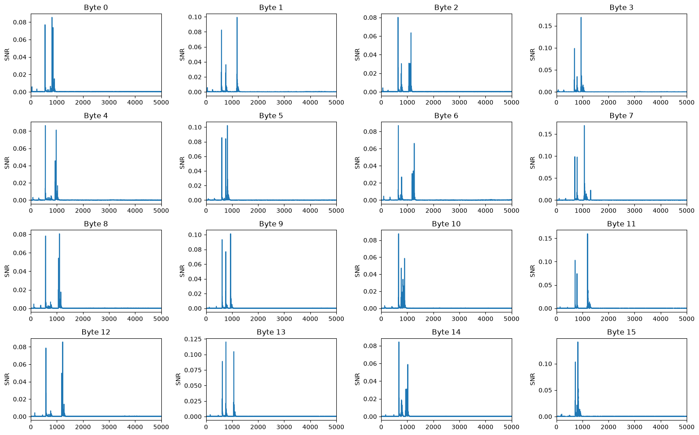

# 作業一：AES 功耗軌跡與 SNR

## 原始題目要求
在 ChipWhisperer Nano 執行 AES-128，擷取 **51,200 條使用隨機明文的功耗軌跡**；針對第一輪 **16 個 S-box 輸出**的漢明重量（HW）各自計算並繪製 SNR trace。題目提到可參考課程 SCA101 的 Power and Hamming Weight Relationship Notebook，並用 matplotlib 繪圖。[HS-009，分享對話內使用者貼上的作業一原題](../../../sources/hs-009.md)

本頁把題目、已保存的實作與缺少的原始資料分開。未提供正式截止日期、評分細則或交件檔名，不自行補上。

## 目前證據到哪裡
| 項目 | 原 Notebook 保存內容 | 本輪確認的界線 |
| --- | --- | --- |
| 目標平台 | CWNANO、TINYAES128C、SS_VER_2_1 | 讀到設定，未重新連裝置 |
| 擷取設定 | TOTAL＝51200、BATCH＝1000 | 有程式與保存輸出，未重新擷取 |
| 批次檔 | 52 個 NPZ，欄位 t／p／k | 有檔案列表輸出，沒有實際批次資料 |
| 合併陣列 | traces `(51200,5000)`、plaintexts `(51200,16)` | 保存輸出，不是本輪重新載入驗證 |
| 明文與 key 檢查 | unique plaintexts＝51200、duplicates＝0；same key＝True | 原執行的檢查結果 |
| SNR | cell 22 有完整計算與 Byte 0–15 的 4×4 圖 | 已核對程式與保存圖片，未重算數值 |

來源：[HS-008，cell 1、10–14、22](../../../sources/hs-008.md)。狀態是「已有作業一保存成果，可補原資料驗證」，不推定已交件或教師已評分。

## 資料欄位與一筆資料的意義
`t[i,j]` 是第 i 次 AES 運算在 sample j 的量測值；`p[i,b]` 是同一次運算的第 b 個明文 byte；k 保存實驗使用的金鑰。**t 與 p 的第 i 列必須代表同一次運算**。批次串接順序若不一致，即使形狀正確也失去對應關係。[HS-008，cell 10、12；本文欄位解讀](../../../sources/hs-008.md)

5000 是這份 Notebook 保存的每條取樣點數，不是題目對所有人的固定要求。沒有完整量測設定時，橫軸保留 sample index，不能自行換成秒。[HS-008，cell 12、22](../../../sources/hs-008.md)

## 理解計算，不只看見一張圖
1. 固定 byte b，從明文與已知實驗金鑰得到第一輪 S-box 輸出。
2. 取該輸出的 HW，得到 0–8 的類別標籤。
3. 對每個 sample，以類別平均的變異作訊號、類別內變異的平均作雜訊。
4. 使用組別樣本數作權重，形成一條 SNR 曲線。
5. 針對 byte 0–15 重複，圖說標明 byte、sample 與 SNR。

以上是原 Notebook cell 18–22 的邏輯導讀；SNR 定義與加權細節見[第四主題](../lessons/04-trace-statistics.md)。[HS-008，ID 0f814646、7aa13ab9；HS-004，PDF p.9–12](../../../sources/hs-008.md)

## 原 Notebook 保存的 SNR 圖

這張圖直接來自使用者 Notebook 的保存輸出，**不是模擬資料，也不是本輪重新執行**。可見十六個 byte 均有曲線，較明顯峰值集中在前段 sample；各格 y 軸尺度不同，不能只比較視覺高度。精確峰值與位置需原始數值或重算，不能從截圖給出假精確數字。[HS-008，cell 22 圖像輸出](../../../sources/hs-008.md)

高峰表示目前 HW 標籤能解釋該時刻的一部分量測變異；它不是恢復金鑰成功率，也不是訊號電壓。SNR 很低的區段也不能證明所有其他中間值都不洩漏。[HS-004，PDF p.9–12，圖表解讀](../../../sources/hs-004.md)

## 原 Notebook 的定位與注意事項
| 內容 | 從 1 起算的 cell／ID |
| --- | --- |
| 裝置與韌體目標 | 1／1fcd17ee |
| 分批擷取 | 10／2e6436c3 |
| 合併批次與形狀 | 12／3453e4d3 |
| 明文不重複檢查 | 14／cec40738 |
| S-box 與 HW | 18／0f814646 |
| 加權 SNR 與繪圖 | 22／7aa13ab9 |

cell 9 是較早的 500-trace 範例文字，不是目前 51,200-trace 程式。cell 15 的合併 NPZ 儲存片段位於 **Markdown cell**，不能因為看見 `np.savez` 就認定它執行過。cell 16 的載入有保存輸出，但目前沒有該 NPZ 檔可獨立驗證。[HS-008，cell 9–16](../../../sources/hs-008.md)

原檔含相對路徑 `../Setup_Scripts/Setup_Generic.ipynb`、工具鏈與外部資料目錄；這份 Wiki 不會自動執行它，搬出原課程環境也不保證直接可跑。本輪只讀保存內容。[HS-008，cell 2、4、10、16](../../../sources/hs-008.md)

## AI 建議：結果說明可以怎麼寫
**自編寫作框架，請依實際數值補入**：先交代裝置、資料筆數、每條 sample 數與固定金鑰；再說明中間值與 HW 分組、組別權重及 SNR 公式；圖說指出各 byte 的可辨峰值與 y 軸差異；最後交代資料檢查、量測限制與是否重算。這不是教師指定格式，也不代填未取得的參數或結果。

## 待補與作業二的關聯
若要重算並核對精確 SNR，需提供 `aes128_batches/` 或合併後的 NPZ，以及實際量測設定；只整理目前網頁不需要先補。作業二要求沿用同一批資料，不能把這張 SNR 圖當 CPA 交件圖。[HS-009](../../../sources/hs-009.md)

接著讀[作業二：CPA 與兩類圖](assignment-02-cpa.md)，或回[課程：SNR](../lessons/04-trace-statistics.md)、[課程：AES](../lessons/02-cryptography.md)。

## 來源
[HS-008](../../../sources/hs-008.md)：24-cell 原始 Notebook，含保存輸出；[HS-009](../../../sources/hs-009.md)：作業原題；[HS-004](../../../sources/hs-004.md)：SNR 理論。未操作硬體、未執行 Notebook、未重新驗證 51,200 條原始資料。
